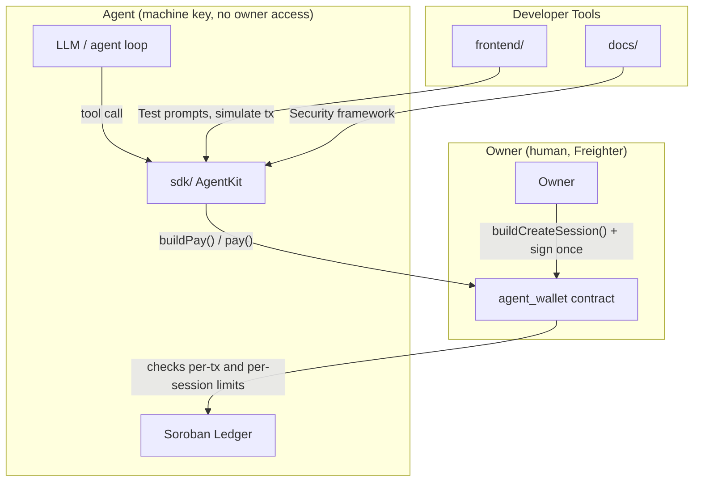

<p align="center">
  
</p>

<p align="center">
  <a href="https://www.drips.network/wave"></a>
  <a href="https://opensource.org/licenses/Apache-2.0"></a>
  <a href="https://stellar.org"></a>
  <a href="https://github.com/nexus-intelligence-xyz"></a>
</p>

<h1 align="center">🤖 Nexus Intelligence</h1>
<h3 align="center">Session-Scoped Agent Wallets for AI-Driven Stellar Payments</h3>

<p align="center">
  <em>Let an AI agent make USDC payments on Stellar without ever holding the owner's keys — the owner signs once to open a time- and amount-bounded session, enforced on-chain by a Soroban agent_wallet contract; the agent's machine key can only spend within that session.</em>
</p>

<p align="center">
  <strong>Status: early-stage, single-repo monorepo · session/payment flow scaffolded, DeFi tool library and multi-sig are open Wave tasks</strong>
</p>

---

## Table of Contents

1. [Why Nexus Intelligence](#why-nexus-intelligence)
2. [Monorepo Layout](#monorepo-layout)
3. [Architecture](#architecture)
4. [Quick Start](#quick-start)
5. [Contracts — Agent Wallet & Spending Sessions](#contracts--agent-wallet--spending-sessions)
6. [SDK — AgentKit](#sdk--agentkit)
7. [Frontend — Playground](#frontend--playground)
8. [Docs — Agent Security Framework](#docs--agent-security-framework)
9. [Drips Wave — Contributing & Earning Points](#drips-wave--contributing--earning-points)
10. [Project Status & Roadmap](#project-status--roadmap)
11. [Community & Support](#community--support)
12. [License](#license)

---

## Why Nexus Intelligence

Letting an LLM-driven agent hold a full Stellar secret key is a single-prompt-injection away from draining the account — there's no on-chain backstop if the model is tricked into authorizing an unintended transfer. Nexus Intelligence's answer is a clean separation of roles: the **owner** (a human, via Freighter) signs once to open a session with hard per-transaction and per-session USDC limits, enforced by a Soroban `agent_wallet` contract; the **agent** gets its own machine keypair that can only spend within that session's on-chain limits, never the owner's key.

| Problem | Nexus Intelligence's Approach |
|---|---|
| Giving an LLM agent direct key control risks unbounded loss | Owner signs once to open a session with on-chain spending limits; the agent gets a separate, limited machine key |
| Spending limits enforced client-side are trivially bypassed | Limits are enforced by the `agent_wallet` Soroban contract itself, not by the SDK |
| Every team re-implements LLM tool-calling glue for payments | `AgentKit` ships ready-made LangChain and OpenAI function-calling tool definitions for `stellar_payment`, `stellar_get_balance`, and `stellar_get_session_status` |
| No safe way to try an agent flow before using it for real | A playground (`frontend/`) for testing agent prompts and simulating the resulting transactions |

This is a Wave-5 Stellar ecosystem project: an early-stage scaffold with the core session/payment flow defined, not a deployed agent platform. There are no agents managing real funds in production today — see [Project Status & Roadmap](#project-status--roadmap) for what's implemented versus open.

---

## Monorepo Layout

Consolidated from four separate repos (`nexus-intelligence-xyz-playground`, `nexus-intelligence-xyz-contracts`, `nexus-intelligence-xyz-sdk`, `nexus-intelligence-xyz-docs`) into one:

```
nexus-intelligence-xyz/
├── frontend/      # React + Vite agent playground (formerly nexus-intelligence-xyz-playground)
├── contracts/     # Soroban agent_wallet / session contracts (formerly nexus-intelligence-xyz-contracts)
├── sdk/           # TypeScript AgentKit SDK (formerly nexus-intelligence-xyz-sdk)
├── docs/          # Docusaurus security framework & guides (formerly nexus-intelligence-xyz-docs)
├── WAVE_TASKS.md  # Point-weighted task backlog for Drips Wave contributors
├── WAVE_ISSUES.md # Full issue specs, organized by component
└── .github/       # Issue templates, PR template, per-component CI workflows
```

Each component keeps its own `package.json`/`Cargo.toml` and builds independently. CI runs per-component, scoped by path.

---

## Architecture



---

## Quick Start

### Prerequisites
- Node.js 18+
- Rust 1.75+ with `wasm32-unknown-unknown` target (for contracts)
- Stellar CLI 21+
- An OpenAI or Anthropic API key, if wiring up an actual LLM loop
- [Freighter wallet](https://www.freighter.app/) for the owner-side session creation

### Clone the monorepo

```bash
git clone https://github.com/nexus-intelligence-xyz/nexus-intelligence-xyz.git
cd nexus-intelligence-xyz
```

### Build & test the contracts

```bash
cd contracts
cargo build --target wasm32-unknown-unknown --release
cargo test

stellar contract deploy \
  --wasm target/wasm32-unknown-unknown/release/agent_wallet.wasm \
  --network testnet \
  --source ADMIN_SECRET_KEY
```

### Use the SDK

```bash
cd sdk
npm install
npm run build && npm test
```

The real entry point is `AgentKit`, exported from `sdk/src/index.ts` along with `NexusToolkit`, `AgentWalletClient`, and `SpendingLimitClient`:

```typescript
import { AgentKit } from '@nexus-intelligence-xyz/sdk';

const kit = new AgentKit({
  rpcUrl: 'https://soroban-testnet.stellar.org',
  network: 'testnet',
  agentWalletContractId: process.env.AGENT_WALLET_CONTRACT_ID!,
  defaultLimitPerTxUsdc: 100,
  defaultLimitPerSessionUsdc: 1000,
});

// 1. Owner opens a session — signs ONCE with Freighter
const { unsignedXdr } = await kit.buildCreateSession({
  agentPublicKey: agentMachinePublicKey,
  ownerPublicKey: ownerFreighterKey,
  limitPerTxUsdc: 100,
  limitPerSessionUsdc: 1000,
});
const signed = await freighter.signTransaction(unsignedXdr, { network: 'TESTNET' });
const { returnValue } = await kit.wallet.submit(signed);
const sessionId = BigInt(returnValue as string);

// 2. The agent (its own machine key, never the owner's) operates within that session
const tools = kit.getLangChainTools(sessionId);
// ...pass `tools` into your LangChain / OpenAI agent loop
```

This is the actual SDK surface as scaffolded today — `buildCreateSession`, `buildPay`/`pay`, `buildRevokeSession`, `getSessionStatus`, `getLangChainTools(sessionId)`, and `getOpenAIFunctions(sessionId)`. A broader DeFi tool library (swaps, staking, lending) does **not** exist yet; it's an open High-complexity task in `WAVE_TASKS.md`, not a shipped feature.

### Run the playground

```bash
cd frontend
npm install
npm run dev
# open http://localhost:5173 to test prompts and simulate transactions
```

---

## Contracts — Agent Wallet & Spending Sessions

`contracts/` — Rust · Soroban SDK

The on-chain enforcement layer: a `session`/`agent_wallet` contract that lets an owner open a session for an agent's machine key with a per-transaction and per-session USDC limit and an expiry, and lets the agent spend only within those bounds.

Open tasks (see `WAVE_TASKS.md`): enhanced rolling-window limit resets, and multi-signature support for the wallet contract.

---

## SDK — AgentKit

`sdk/` — TypeScript · `@stellar/stellar-sdk`

- **`AgentKit`** — the main entry point; builds unsigned XDR for session creation, payment, and session revocation, and exposes `wallet` (an `AgentWalletClient`) and `tools` (a `NexusToolkit`) directly
- **`NexusToolkit`** — generates `stellar_payment`, `stellar_get_balance`, and `stellar_get_session_status` tool definitions in both LangChain (`getLangChainTools`) and OpenAI function-calling (`getOpenAIFunctions`) formats
- **`AgentWalletClient`** — the lower-level client wrapping the `agent_wallet` contract; distinguishes the owner-signing path (create/revoke session) from the agent-signing path (payments)
- **`SpendingLimitClient`** — policy configuration (`maxTxAmountUsdc`, `maxDailyAmountUsdc`)

A broader DeFi tool library (swap/stake/lend/borrow) and LlamaIndex integration are open Wave tasks, not current SDK exports.

---

## Frontend — Playground

`frontend/` — React 18 · TypeScript · Vite

A planned interactive environment for testing agent prompts and simulating the resulting transactions before connecting a real agent to a real session. Check `WAVE_TASKS.md` for current implementation status — the prompt-testing interface and transaction-simulation viewer are both open High-complexity tasks.

---

## Docs — Agent Security Framework

`docs/` — Docusaurus 3 · Markdown

Planned content: an Agent Security Framework document covering session design and key-separation best practices, a prompt-injection prevention guide, and integration guides for LangChain and OpenAI tool-calling.

---

## Drips Wave — Contributing & Earning Points

Nexus Intelligence participates in the **Stellar Drips Wave** program ([drips.network/wave](https://www.drips.network/wave)). Contributors pick up point-weighted tasks and earn rewards on merge.

**Point values:** 🟢 Trivial — 100 · 🟡 Medium — 150 · 🔴 High — 200

Full backlog: [`WAVE_TASKS.md`](./WAVE_TASKS.md) and [`WAVE_ISSUES.md`](./WAVE_ISSUES.md) (organized by `contracts`, `sdk`, `frontend`, `docs`).

**How to contribute:**
1. Browse open tasks — the DeFi tool library, multi-sig wallet, and playground UI are good high-value starting points
2. Apply at [drips.network/wave](https://www.drips.network/wave) with your GitHub account
3. Fork, branch, implement, open a PR referencing the issue
4. Earn points once merged

See [`CONTRIBUTING.md`](./CONTRIBUTING.md) and [`CODE_OF_CONDUCT.md`](./CODE_OF_CONDUCT.md).

---

## Project Status & Roadmap

**Honest current status:** every task in `WAVE_TASKS.md` is currently marked **Open**. The session-creation, payment, and tool-definition flow is scaffolded in the SDK; the DeFi tool library, multi-sig wallet, and playground UI are not yet built. No agent is managing real funds in production.

**Now (scaffolded, open for contribution):**
- `AgentKit` with `buildCreateSession`, `buildPay`/`pay`, `buildRevokeSession`, `getSessionStatus`
- `NexusToolkit` with `stellar_payment`, `stellar_get_balance`, `stellar_get_session_status` in LangChain and OpenAI formats
- `agent_wallet`/session contract skeleton in `contracts/`
- Playground and docs scaffolds

**Next:**
- Implement and test rolling-window spending-limit resets and multi-signature wallet support
- Build a pre-built DeFi tool library (swaps, staking, lending) on top of the existing session model
- Build the playground's prompt-testing and transaction-simulation UI
- Write the Agent Security Framework document

**Later / vision:**
- LlamaIndex and additional agent-framework integrations
- Agent behavior analytics, if/when there's real usage to analyze
- Cross-chain agent sessions

---

## Community & Support

- **Issues** — [GitHub Issues](https://github.com/nexus-intelligence-xyz/nexus-intelligence-xyz/issues)
- **Discussions** — GitHub Discussions for questions and design conversations
- **Contributing** — [`CONTRIBUTING.md`](./CONTRIBUTING.md)
- **Code of Conduct** — [`CODE_OF_CONDUCT.md`](./CODE_OF_CONDUCT.md)
- **Security** — [`SECURITY.md`](./SECURITY.md)
- **Maintainer** — [@phantomcall](https://github.com/phantomcall)

---

## License

Distributed under the **Apache License 2.0**. See [`LICENSE`](./LICENSE) for details.

```
Copyright 2026 Nexus Intelligence Contributors

Licensed under the Apache License, Version 2.0 (the "License");
you may not use this file except in compliance with the License.
You may obtain a copy of the License at

    http://www.apache.org/licenses/LICENSE-2.0

Unless required by applicable law or agreed to in writing, software
distributed under the License is distributed on an "AS IS" BASIS,
WITHOUT WARRANTIES OR CONDITIONS OF ANY KIND, either express or implied.
See the License for the specific language governing permissions and
limitations under the License.
```

<p align="center">
  <strong>🤖 Bounded, on-chain-enforced agent payments on Stellar.</strong>
</p>
