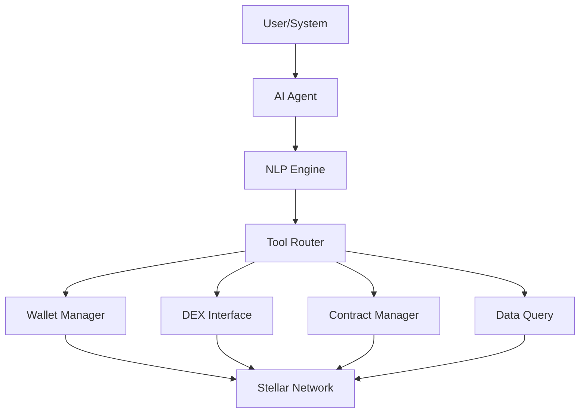

# Introduction

Welcome to Nexus Intelligence - the AI agent framework for autonomous Stellar blockchain interactions.

## What is Nexus Intelligence?

Nexus Intelligence enables AI agents to interact with the Stellar blockchain autonomously. It provides a secure, high-level interface for agents to manage wallets, execute trades, deploy contracts, and more - all through natural language commands.

## Key Features

- **Natural Language Interface** - Agents use plain English
- **Multi-Agent Coordination** - Agents work together
- **Secure Key Management** - Hardware wallet integration
- **Smart Contract Deployment** - AI-driven contract creation
- **DeFi Operations** - Autonomous trading and liquidity provision
- **Event Monitoring** - Real-time blockchain observation

## Why Nexus Intelligence?

AI agents need to interact with blockchains, but current tools are developer-focused. Nexus Intelligence bridges this gap:

- **Agent-First Design** - Built for LLMs and autonomous agents
- **Safety Guardrails** - Prevent costly mistakes
- **Context Awareness** - Agents remember past interactions
- **Tool Abstraction** - Complex operations made simple
- **Multi-Model Support** - Works with GPT-4, Claude, Llama, etc.

## Quick Example

```python
from nexus-intelligence-xyz import StellarAgent

# Initialize agent
agent = StellarAgent(
    model="gpt-4",
    wallet_key="secret_key_here"
)

# Natural language command
response = await agent.execute(
    "Send 100 USDC to Alice and swap 50 XLM for USDC on the DEX"
)

# Agent handles:
# 1. Parse command
# 2. Validate addresses
# 3. Check balances
# 4. Execute payment
# 5. Execute swap
# 6. Return confirmation
```

## Use Cases

- **Portfolio Management** - AI-managed crypto portfolios
- **Trading Bots** - Autonomous DEX trading
- **Smart Contract Agents** - AI-deployed contracts
- **DAO Governance** - AI-assisted voting
- **DeFi Automation** - Yield farming optimization
- **Research Agents** - Blockchain data analysis

## Architecture



## Agent Capabilities

### Wallet Operations
- Create and manage wallets
- Send and receive payments
- Check balances and transactions
- Multi-signature coordination

### DeFi Operations
- DEX trading (limit/market orders)
- Liquidity provision
- Yield farming strategies
- Portfolio rebalancing

### Smart Contracts
- Deploy new contracts
- Invoke contract functions
- Monitor contract events
- Upgrade contracts

### Data & Analytics
- Query blockchain data
- Analyze market trends
- Generate reports
- Detect anomalies

## Safety Features

- **Simulation Mode** - Test commands without executing
- **Spending Limits** - Cap transaction amounts
- **Whitelist Addresses** - Restrict recipient addresses
- **Human Approval** - Require confirmation for large operations
- **Audit Logging** - Complete operation history

## Getting Started

- [Installation](./getting-started/installation) - Set up the framework
- [Your First Agent](./tutorials/first-agent) - Create an AI trading agent
- [Agent Architecture](./architecture/overview) - Understand the system
- [Safety Guide](./guides/safety) - Best practices for agent safety

## Supported Models

- **OpenAI** - GPT-4, GPT-3.5
- **Anthropic** - Claude 3, Claude 2
- **Open Source** - Llama 2, Mistral, Mixtral
- **Custom** - Bring your own model

## Community

- [GitHub](https://github.com/nexus-intelligence-xyz/nexus-intelligence-xyz)
- [Discord](https://discord.gg/nexus-intelligence-xyz)
- [Drips Wave](https://www.drips.network/wave) - Contribute and earn

Ready to build autonomous agents on Stellar? Let's create your first agent!
